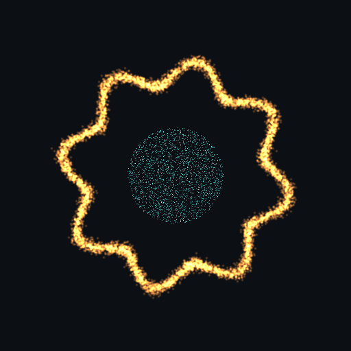
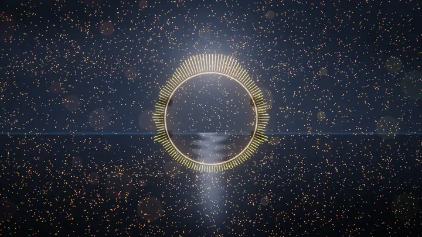
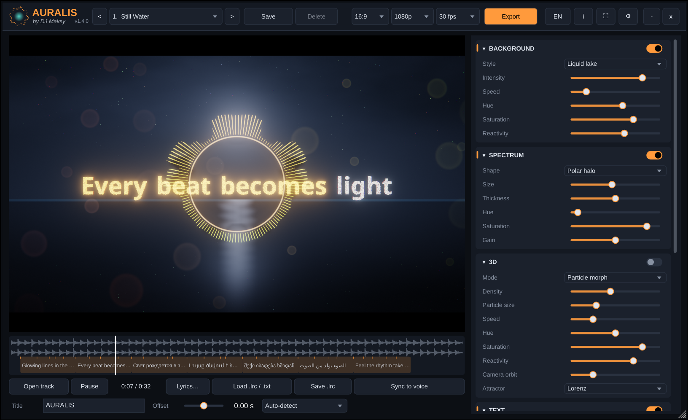
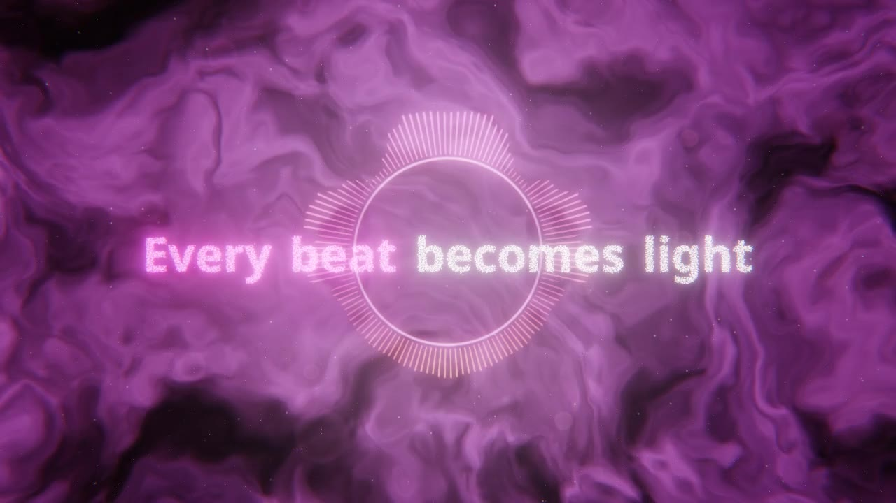
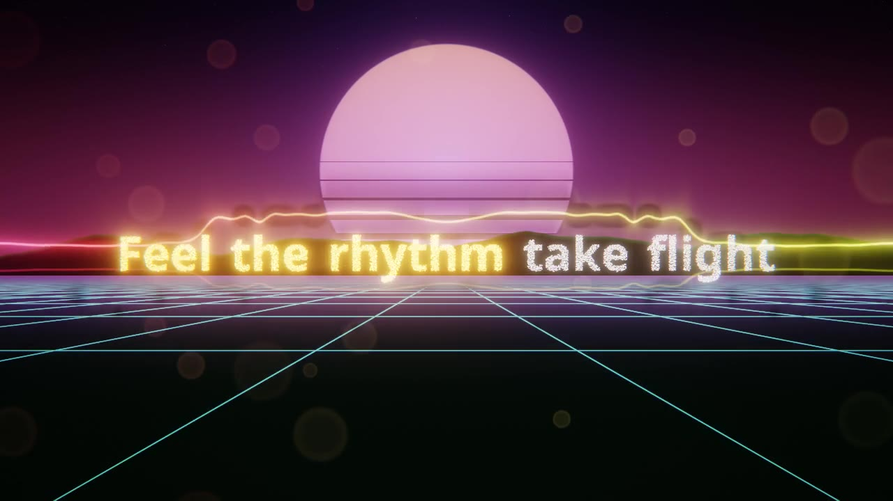
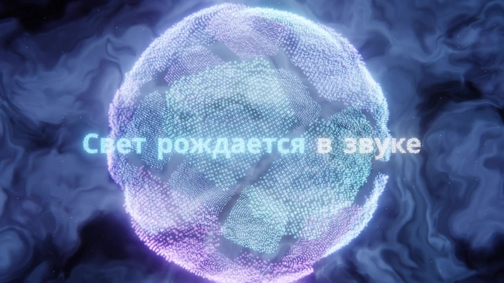
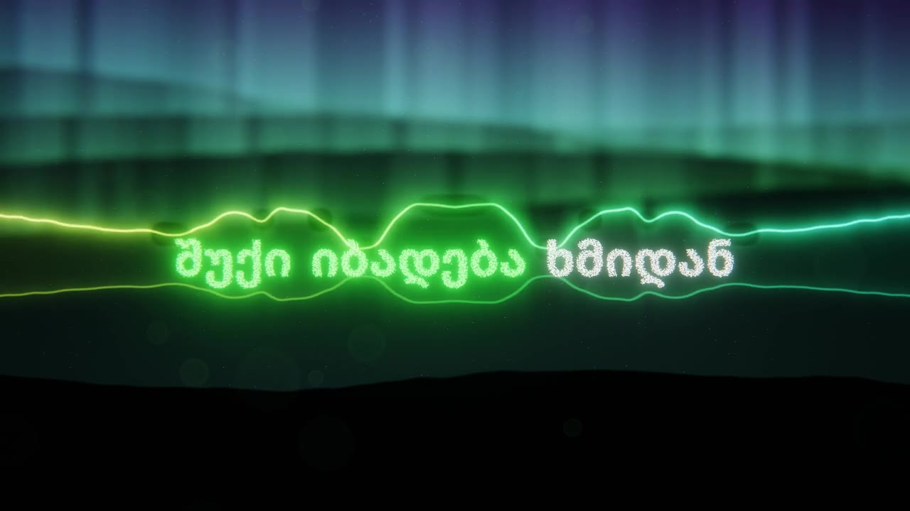
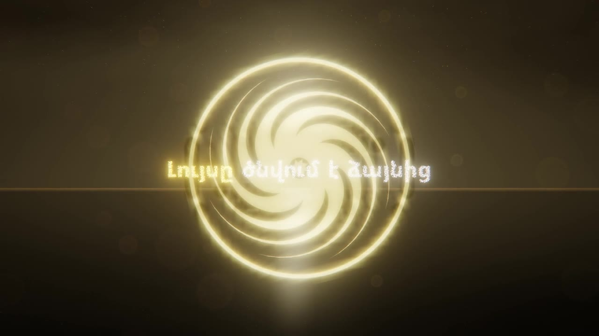
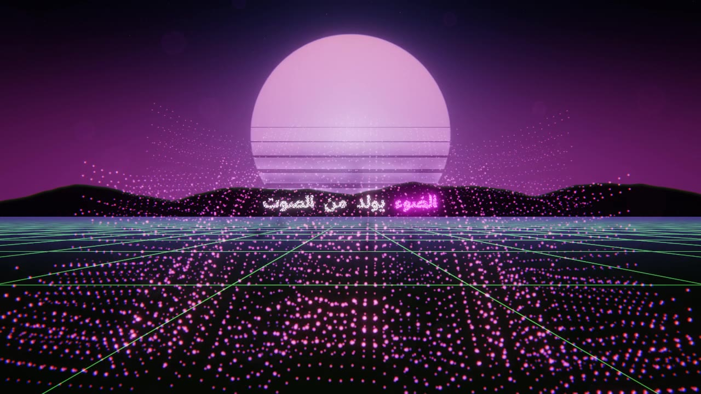

<p align="center">
  
</p>

<h1 align="center">Auralis</h1>

<p align="center">
  <b>by DJ Maksy</b><br>
  Turn any song into a living music video — right inside your DAW.
</p>

<p align="center">
  <a href="https://github.com/djmaksy/auralis/releases/latest"></a>
  
  
  
  <a href="https://djmaksy.com"></a>
</p>

<p align="center">
  <b>English</b> · <a href="README.ru.md">Русский</a>
</p>

<p align="center">
  
</p>

Drop **Auralis** last on your master bus. It listens to the finished mix — every spectrum band,
every kick, the stereo image, the host's tempo — and turns it into light: glowing lakes, nebulae,
neon grids, 3D particle storms, and your lyrics forming out of particles in time with the voice.

When you export audio from your DAW, Auralis quietly renders a matching **MP4 with your sound**,
frame by frame, up to **4K**. No screen capture, no dropped frames, and the same result every time.

<p align="center">
  <a href="https://github.com/djmaksy/auralis/releases/latest"><b>⬇ Download the latest version for Windows</b></a>
</p>

---

## ✨ Highlights

- 🎛 **Works everywhere** — VST3 plug-in for any Windows DAW (Ableton, FL Studio, Cubase, Reaper, Studio One, Bitwig…) plus a standalone app.
- 🌌 **Layered visuals** — background, spectrum, 3D particles, lyrics, ornaments, optics and your own video, mixed like layers in a graphics editor.
- 🎤 **Lyrics that sync themselves** — paste the words and Auralis finds them in the vocal (17 languages), or load an `.lrc`.
- 🔤 **Five scripts** — Latin, Cyrillic, Armenian, Georgian and Arabic (right-to-left, with joined letters).
- 🎬 **Export without "Create Video"** — just bounce your track; the MP4 appears next to it.
- 📐 **16:9, 9:16 and 1:1** — vertical videos for Reels/Shorts/TikTok are framed by the short side, never cropped.
- 🎨 **62 presets** — from a calm lake to neon cities and shattering spheres; save your own.
- 🔁 **Frame-accurate** — time is locked to audio samples, so every export is identical.

## 🖥 The window

<p align="center">
  
</p>

Live picture on the left, layers on the right, your synced lyrics under the waveform.
Double-click any slider to reset it, right-click to modulate it from the bass, the hits or the beat.

## 🎨 Presets

<table>
  <tr>
    <td><p align="center">Nebula Bloom</p></td>
    <td><p align="center">Sunset Drive</p></td>
    <td><p align="center">Sphere Fracture</p></td>
  </tr>
  <tr>
    <td><p align="center">Northern Lights</p></td>
    <td><p align="center">Eternity Wheel</p></td>
    <td><p align="center">Neon Blocks</p></td>
  </tr>
</table>

Six of the 62 presets, each one reacting to the music in real time.

## 🧩 Layers

| Layer | What's inside |
|---|---|
| **Background** | liquid lake · nebulae · hyperspace flight · northern lights · retro grid |
| **Spectrum** | polar halo · neon line · hex cells |
| **3D** | particle morph · curl flow · strange attractors (Lorenz, Aizawa, Thomas) · spectrum terrain · shattering sphere |
| **Text** | title or lyrics made of particles; appearance: fly in / fade in / instant; separate colours for sung words |
| **Ornament** | Armenian and Georgian motifs: arevakhach, khachkar, borjgali |
| **Optics** | bloom · bokeh · chromatic aberration · vignette · exposure |
| **Video** | your clip or image, full frame or framed, with colour grading, grain, scanlines, slow motion and beat-synced jumps |

## 🚀 Quick start

1. **Install** — run `Auralis-<version>-Setup.exe` from [Releases](https://github.com/djmaksy/auralis/releases/latest).
   It installs the app and the VST3 plug-in. Windows may show *"Windows protected your PC"* because
   the build isn't code-signed yet: click **More info → Run anyway**.
2. **Insert** Auralis as the **last** effect on your master bus and rescan plug-ins if needed.
3. **Pick a look** — step through presets with the arrows in the header.
4. **Add lyrics** — **Lyrics…** → paste the words → **Apply and sync to voice**, or drop an `.lrc` onto the window.
5. **Export** — choose aspect, resolution, fps and bitrate, then simply export audio from your DAW.
   The video lands in `Videos\Auralis`. In the standalone app use **Export → Render loaded track to MP4**.

## ⌨ Handy shortcuts

| Key / action | Does |
|---|---|
| **D** or double-click the picture | full screen |
| **← / →** | previous / next preset |
| **Space** | play / pause (standalone) |
| Double-click a slider | reset to default |
| Right-click a slider | modulate from bass / mids / highs / hits / loudness / beat or bar LFO |
| Drop a file | track, video, image, `.txt`, `.lrc` or preset |

## 💻 System requirements

- Windows 10 or 11, 64-bit
- A graphics card with OpenGL 3.2 (anything from the last ~10 years)
- Any VST3 host for the plug-in; the standalone app needs nothing else
- Lyrics recognition downloads the Whisper model once (~470 MB)

Video is encoded with Windows' built-in Media Foundation (H.264 + AAC). If `ffmpeg.exe` sits next
to the app, it's used as a fallback encoder.

<details>
<summary><b>🛠 Building from source</b></summary>

Requirements: Visual Studio 2022 (C++ workload), CMake 3.22+, Git.

```bat
cmake -S . -B build -G "Visual Studio 17 2022" -A x64
cmake --build build --config Release --target Auralis_VST3 Auralis_Standalone
```

- `build\Auralis_artefacts\Release\Standalone\Auralis.exe` — the app
- `build\Auralis_artefacts\Release\VST3\Auralis.vst3` — copy to `C:\Program Files\Common Files\VST3\`

JUCE and whisper.cpp are downloaded automatically on the first configure.

| CMake option | Effect |
|---|---|
| `-DAURALIS_ASIO_SDK=path\to\asiosdk` | ASIO in the standalone app |
| `-DAURALIS_WHISPER_VULKAN=ON` | lyrics recognition on the GPU (needs the Vulkan SDK) |
| `-DAURALIS_WITH_WHISPER=OFF` | build without recognition |

Command-line render:

```bat
Auralis.exe --render song.wav --out video.mp4 --preset 5 --res 1080 --aspect 9:16 --lyrics song.lrc --bitrate 16
```

Every push to `main` is built by GitHub Actions and published as a release named after `VERSION`.

```
Source/Core       sound analysis, parameters, presets, modulation (unit-tested)
Source/Render     OpenGL: shaders, particles, text, ornaments, optics
Source/Engine     sound → frame pipeline
Source/Lyrics     LRC/TXT, word alignment, recognition (whisper.cpp)
Source/Export     offline render, Media Foundation / ffmpeg
Source/UI         user interface
Source/Standalone standalone app and command-line renderer
```

</details>

## 📜 Changelog

See [CHANGELOG.md](CHANGELOG.md). Every change gets its own version number.

## 🙏 Credits

Made by **[DJ Maksy](https://djmaksy.com)**.

Built with [JUCE](https://juce.com) (AGPLv3 / commercial), [whisper.cpp](https://github.com/ggml-org/whisper.cpp) (MIT)
and the [Noto](https://notofonts.github.io) fonts (SIL Open Font License 1.1).
Closed-source distribution or sale requires a commercial JUCE licence.
